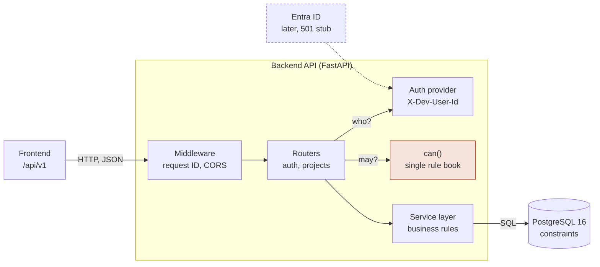
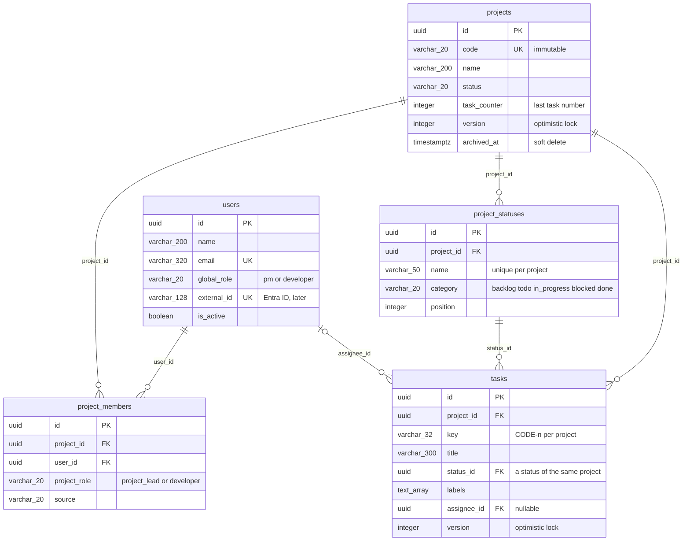
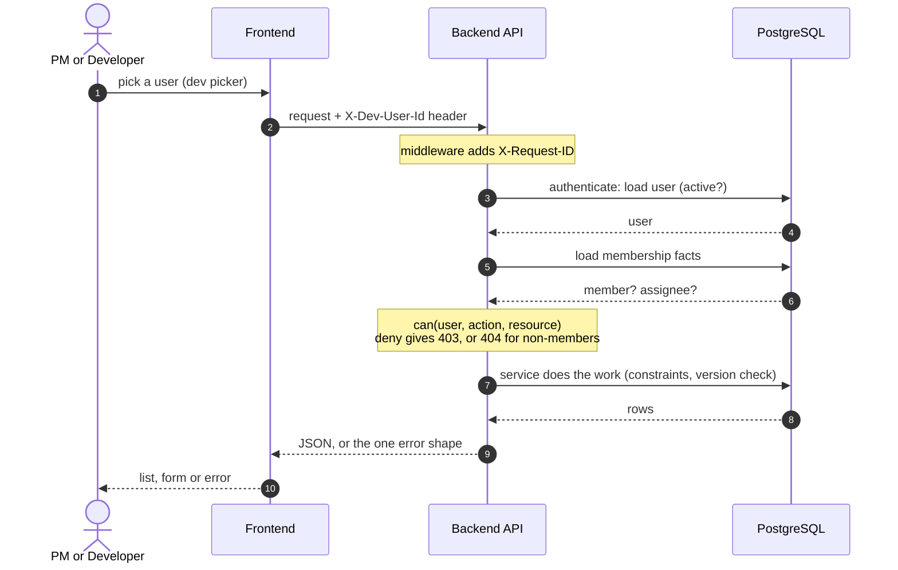

# Backend

FastAPI service for Borek PM Hub. Python **3.12** (same version as the Docker image and CI).

## How the backend fits together

Read this first if you change anything in `backend/`. Rules that hold everywhere:

- Routers check **permissions** (through `can()`), services check **data and business rules** and talk to the database.
- The server enforces every permission. Hiding a button in the UI is not security.
- Nothing is physically deleted; rows get `archived_at`.
- Every error has the same shape: `{"error": {"code", "message", "details"}, "request_id": "..."}`.

Polished standalone versions (open in a browser after cloning; GitHub only shows their source):
[architecture](../docs/diagrams/architecture.html), [database schema](../docs/diagrams/database-schema.html), [data flow](../docs/diagrams/data-flow.html).

### Architecture



| Folder | Role |
|---|---|
| `app/main.py`, `app/api.py` | Create the app; mount routers under `/api/v1` |
| `app/auth/` | `dependencies.py` (current user), `providers/dev.py` (Phase 1 login), `providers/entra.py` (stub), `permissions.py` (`can()`) |
| `app/projects/` | `router.py` (HTTP + permission checks), `service.py` (rules), `models.py`, `schemas.py` |
| `app/tasks/` | `router.py` (statuses, tasks, assignment, `/me/tasks`), `service.py` (task rules, filters, board, assignment), `statuses.py` (per-project statuses), `models.py`, `schemas.py` |
| `app/users/` | User model |
| `app/core/` | Config, async DB session, errors, logging, request-ID middleware |
| `alembic/`, `scripts/seed.py`, `tests/` | Migrations, demo data, pytest |

### Database schema

Five tables, integrity enforced by the database. All foreign keys use PostgreSQL's default `ON DELETE NO ACTION`.
Subsystem view: `created_by` / `granted_by` foreign keys, dates and other columns are omitted. Full DDL: `alembic/versions/0001_initial_schema.py` and `0002_custom_statuses.py`.



Key constraints: unique `projects.code`, unique `(project_id, user_id)` per membership, unique `(project_id, key)` per task, an estimate needs both amount and unit (amount above 0), a task can only use a status of its own project, unique status name per project. A task in a blocked-category status needs a reason (checked in the service).
A `version` column on projects and tasks gives optimistic locking: a stale update gets `409`.

### Data flow of one request

Same path for every endpoint (the example is any call that reads or writes a project).



## Run locally with a virtual environment (Windows, Command Prompt)

```
cd backend
py -3.12 -m venv .venv
.venv\Scripts\activate
python -m pip install --upgrade pip
pip install -r requirements-dev.txt
copy .env.example .env
uvicorn app.main:app --reload
```

Open http://localhost:8000/docs and http://localhost:8000/health.

## Run everything with Docker (API + database)

From the repository root:

```
copy backend\.env.example backend\.env
docker compose up --build
```

## Sign-in modes and accounts

`AUTH_MODE` in `backend/.env`:

| Mode | What it is | Where |
|---|---|---|
| `dev` | Pick a seeded user; no password (header `X-Dev-User-Id`). | Local only. The app refuses to start with it when `ENVIRONMENT=production`. |
| `local` | Email + password. `POST /auth/login` returns a bearer token (Argon2 hashes, 5 wrong passwords lock the account for 15 minutes). Needs `SECRET_KEY` (32+ characters). | Staging, pilot, and for people outside the Microsoft tenant. |
| `entra` | Microsoft Entra ID. Not built yet (returns 501). | Later. |

**QA accounts (one PM, one developer).** Set `BOOTSTRAP_PM_PASSWORD` and `BOOTSTRAP_DEV_PASSWORD`
(12+ characters, your own choice) in `backend/.env`. `docker compose up` then creates
`qa.pm@borek.test` and `qa.dev@borek.test` on every start if they are missing
(`python -m scripts.bootstrap_users`; add `--reset-passwords` to overwrite). On a server run the same
command after `alembic upgrade head`, with the variables set in that environment.

**Any other account** is created with plain SQL. Get a hash with `python -m scripts.hash_password`, then:

```sql
INSERT INTO users (name, email, global_role, password_hash)
VALUES ('Full Name', 'name@example.com', 'developer', '<hash>');
-- later password change:
UPDATE users SET password_hash = '<hash>', failed_login_count = 0, locked_until = NULL
WHERE email = 'name@example.com';
```

`global_role` is `pm` or `developer`. To switch someone off: `UPDATE users SET is_active = false ...`.

## Checks (the same ones CI runs)

```
ruff check .
ruff format --check .
mypy app
pytest
```

Fix formatting automatically with `ruff check . --fix` and `ruff format .`.

## Dependencies

Versions are pinned in `requirements.txt` (runtime) and `requirements-dev.txt` (tools).
Change a version in the file, rebuild the Docker image and reinstall in the venv together.
