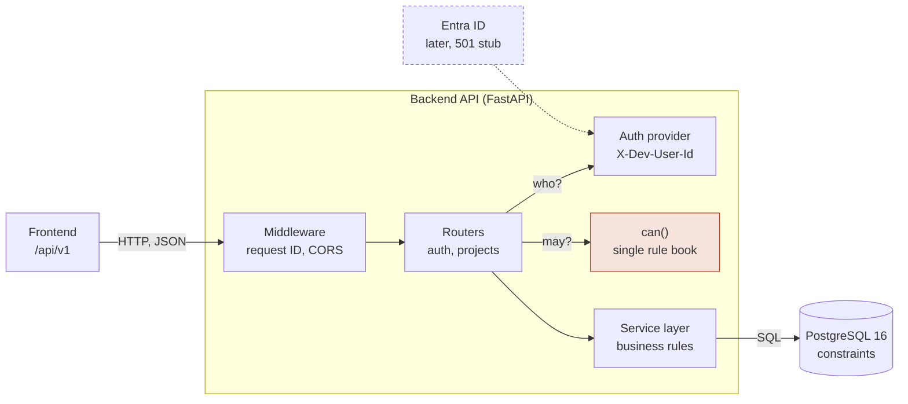
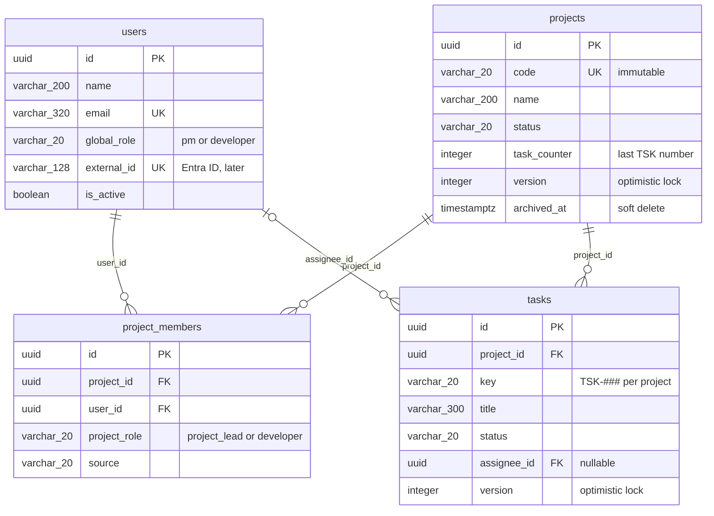
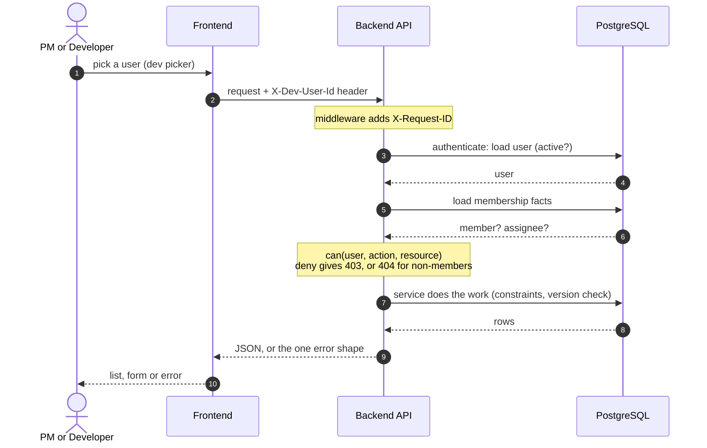

# Backend

FastAPI service for Borek PM Hub. Python **3.12** (same version as the Docker image and CI).

## How the backend fits together

Read this first if you change anything in `backend/`. Rules that hold everywhere:

- Routers check **permissions** (through `can()`), services check **data and business rules** and talk to the database.
- The server enforces every permission. Hiding a button in the UI is not security.
- Nothing is physically deleted; rows get `archived_at`.
- Every error has the same shape: `{"error": {"code", "message", "details"}, "request_id": "..."}`.

Polished standalone versions (open in a browser after cloning; GitHub only shows their source):
[architecture](../docs/diagrams/architecture.html), [database schema](../docs/diagrams/database-schema.html), [data flow](../docs/diagrams/data-flow.html).

### Architecture



| Folder | Role |
|---|---|
| `app/main.py`, `app/api.py` | Create the app; mount routers under `/api/v1` |
| `app/auth/` | `dependencies.py` (current user), `providers/dev.py` (Phase 1 login), `providers/entra.py` (stub), `permissions.py` (`can()`) |
| `app/projects/` | `router.py` (HTTP + permission checks), `service.py` (rules), `models.py`, `schemas.py` |
| `app/tasks/`, `app/users/` | Models (task endpoints are not built yet) |
| `app/core/` | Config, async DB session, errors, logging, request-ID middleware |
| `alembic/`, `scripts/seed.py`, `tests/` | Migrations, demo data, pytest |

### Database schema

Four tables, integrity enforced by the database. All foreign keys use PostgreSQL's default `ON DELETE NO ACTION`.
Subsystem view: `created_by` / `granted_by` foreign keys, dates and other columns are omitted. Full DDL: `alembic/versions/0001_initial_schema.py`.



Key constraints: unique `projects.code`, unique `(project_id, user_id)` per membership, unique `(project_id, key)` per task, `progress` between 0 and 100, a `blocked` task needs a reason.
A `version` column on projects and tasks gives optimistic locking: a stale update gets `409`.

### Data flow of one request

Same path for every endpoint (the example is any call that reads or writes a project).



## Run locally with a virtual environment (Windows, Command Prompt)

```
cd backend
py -3.12 -m venv .venv
.venv\Scripts\activate
python -m pip install --upgrade pip
pip install -r requirements-dev.txt
copy .env.example .env
uvicorn app.main:app --reload
```

Open http://localhost:8000/docs and http://localhost:8000/health.

## Run everything with Docker (API + database)

From the repository root:

```
copy backend\.env.example backend\.env
docker compose up --build
```

## Checks (the same ones CI runs)

```
ruff check .
ruff format --check .
mypy app
pytest
```

Fix formatting automatically with `ruff check . --fix` and `ruff format .`.

## Dependencies

Versions are pinned in `requirements.txt` (runtime) and `requirements-dev.txt` (tools).
Change a version in the file, rebuild the Docker image and reinstall in the venv together.
